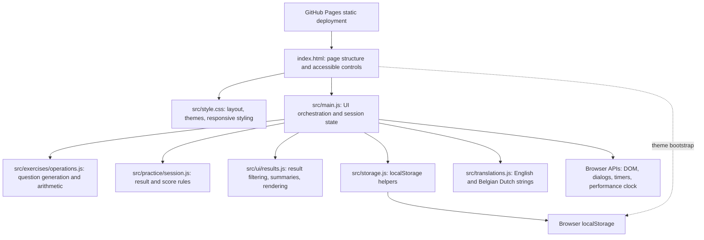

# Math Sprout Architecture

## Purpose and status

This document describes the architecture currently implemented in the repository. It is intended to help maintainers and coding agents understand the existing boundaries and constraints before changing the app. It is not a roadmap or a specification for features that do not exist yet.

The app is a small, client-side maths practice experience for children. It runs in the browser, has no application server or backend, and is published as a static site. The architecture favors browser-native APIs and small JavaScript modules over a framework.

## System overview

## Runtime and data flow

1. `index.html` supplies the semantic page structure and controls, loads `src/style.css`, and starts `src/main.js` as an ES module.
2. Before the page is styled, a small inline script reads and validates the saved theme from `localStorage`, then sets theme data attributes on the document. This avoids initially rendering with the wrong theme when a valid preference exists.
3. `main.js` reads the saved language and username, applies translations, configures event handlers, and coordinates DOM updates. It owns the active practice session and its transient state.
4. When a session starts, the selected operation and its settings are passed to `src/exercises/operations.js`, which generates operands and calculates the answer. Random generation defaults to `Math.random`; helpers accept an injected random function to make their behavior testable.
5. Answers and skips are recorded in in-memory session state. The elapsed time uses the browser's monotonic `performance.now()` clock. Stopping a session opens a results dialog; `src/ui/results.js` filters and renders the results and computes summary times.
6. Usernames, language, and theme preferences are stored locally in the browser. Practice history and session results are not persisted. No data is sent to a server by the app.

## Code boundaries

| Area | Responsibility |
| --- | --- |
| `index.html` | Accessible page markup, labels, controls, dialogs, and startup scripts. |
| `src/main.js` | DOM wiring, translations and theme application, settings, session lifecycle, and transient application state. |
| `src/exercises/operations.js` | Random-number helpers and the four arithmetic operation definitions, including operand generation. |
| `src/practice/session.js` | Pure helpers for score counting and converting an exercise into a result record. |
| `src/ui/results.js` | Pure result-list selection and average calculation, plus DOM rendering of the results dialog. |
| `src/storage.js` | Small helpers for reading and writing supported local preferences. |
| `src/translations.js` | English and Belgian Dutch message dictionaries. |
| `src/style.css` | Visual system, responsive layout, and theme styling driven by document data attributes and CSS variables. |
| `*.test.js` beside source modules | Vitest tests for operation generation, session calculations, storage helpers, translations, and results helpers. |

`main.js` is the integration point: domain helpers do not own the DOM, while the entry point selects inputs, coordinates state, and renders changes. Prefer keeping arithmetic and session rules independently testable as the app grows.

## State and persistence

- **Persistent browser preferences:** theme color/mode (`math-sprout.theme`), language (`math-sprout.language`), and optional username (`math-sprout.username`).
- **Transient state:** selected exercise settings, current question, answers, scores, timings, results, open dialogs, and feedback live in memory and are lost on reload.
- **No account or synchronization:** preferences are scoped to the current browser's origin and are not shared across devices.
- **Storage failures:** the UI handles unavailable browser storage for preference changes by keeping the current-visit choice where practical and showing status feedback. Preserve this graceful behavior when changing persistence.

## Build, test, and deployment

- `npm test` runs the Vitest suite.
- `npm run dev` starts the Vite development server.
- `npm run build` creates the static production site in `dist`.
- `npm run preview` serves the production build locally.
- `.github/workflows/build.yml` runs tests and a production build on pull requests and pushes to `master`.
- `.github/workflows/deploy.yml` builds and tests the app, then deploys the static build to GitHub Pages on pushes to `master` or manual dispatch.
- `vite.config.js` uses a relative base path so the built site can be served from a GitHub Pages project path.

Because the page uses JavaScript ES modules, use the Vite development server for reliable local development rather than relying on a browser's `file://` behavior.

## Current architectural constraints

- There is no backend, API, database, authentication, or remote persistence.
- The app is a single-page experience with a single main orchestration module; it is not currently divided into a component framework or a formal state-management layer.
- Only the username, language, and theme are persisted. Changes to progress tracking, accounts, or cross-device synchronization would require an explicit data and privacy design rather than extending the current preference storage implicitly.
- The four operation types and the current settings are implemented directly in the page and operation definitions. New exercise formats may need a broader exercise model, but that is not present today.
- The app targets touch-friendly phone and tablet use and includes English and Belgian Dutch UI strings. Keep labels and accessibility attributes in sync when changing controls.

## Keeping this document useful

Treat this as a reviewed description of the implementation, not as generated output. Update it when a change materially alters module boundaries, data flow, persistence, runtime dependencies, or deployment. Routine UI changes and new isolated tests do not need an architecture-document edit.

When updating it, verify statements against the code and workflows in the same change. Remove or revise obsolete descriptions instead of appending release-by-release snapshots. A periodic review can catch drift, but should result in a proposed edit for human review rather than silently rewriting this document.
